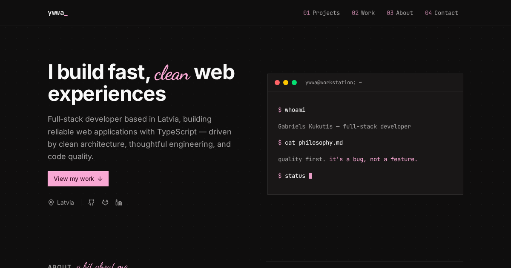

# vantage

Portfolio site for Gabriels Kukutis — [ywwa.cc](https://ywwa.cc).



A single-page React app served from the edge. Site copy lives in typed files under `src/react-app/data`, and the worker handles `/favicon.ico` and `/robots.txt` alongside the static assets.

## Stack

- [React 19](https://react.dev) + [TypeScript](https://www.typescriptlang.org)
- [Vite](https://vite.dev) for dev server and builds
- [Tailwind CSS v4](https://tailwindcss.com) for styling
- [Hono](https://hono.dev) on [Cloudflare Workers](https://developers.cloudflare.com/workers/)
- [Lenis](https://lenis.darkroom.engineering/) for smooth scrolling

## Development

Requires [pnpm](https://pnpm.io/).

```bash
pnpm install
pnpm dev
```

## Scripts

| Command            | Description                                  |
| ------------------ | -------------------------------------------- |
| `pnpm dev`         | Start the dev server                         |
| `pnpm build`       | Type-check and build for production          |
| `pnpm preview`     | Build and preview the production output      |
| `pnpm deploy`      | Deploy the worker with Wrangler              |
| `pnpm check`       | Type-check, build, and dry-run a deploy      |
| `pnpm lint`        | Lint with oxlint                             |
| `pnpm format`      | Format with oxfmt                            |
| `pnpm screenshot`  | Capture project screenshots (Playwright)     |

## Structure

```
src/
  react-app/    React frontend (components, routes, data, lib)
  worker/       Hono worker
scripts/        Screenshot and Open Graph capture scripts
```

## Deploy

```bash
pnpm build && pnpm deploy
```
